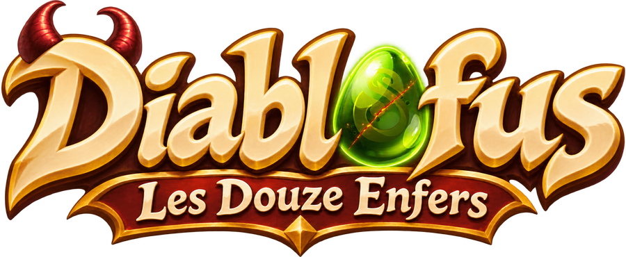

<p align="center"></p>

# Diablofus : Les Douze Enfers

**[Jouer dans le navigateur](https://mathiss29.github.io/dofus-diablo/)**

ARPG en temps réel dans l'univers de Dofus 3, jouable dans le navigateur (PC, clavier et souris).
On incarne une classe de Dofus, on nettoie des zones du Monde des Douze et on ramasse du butin, avec un combat nerveux à la Diablo 4.

Doc de conception : « Dofus diablo — bases du jeu » (Claude Docs).

## Lancer le jeu

```bash
npm install
npm run dev        # http://localhost:5173
npm test           # tests de la simulation
npm run build      # version en ligne dans dist/
```

## Contrôles

| Touche | Action |
| --- | --- |
| ZQSD / WASD / flèches | Se déplacer |
| Clic gauche (maintenu) | Attaque, combo en 3 coups |
| Clic droit ou 1 | Épée Céleste |
| Espace | Bond (annule tout, invulnérable) |
| R ou 2 | Colère de Iop |
| F | Effets d'impact on/off |
| H | Masquer l'aide |

## Organisation

```
src/
  sim/      Simulation pure : joueur, monstres, IA, collisions, vagues.
            Aucune dépendance à Phaser ni au navigateur. Tourne dans les tests,
            et pourra tourner sur un serveur pour la coop.
  render/   Affichage Phaser : sprites, carte, effets, interface. Lit l'état de
            la simulation et consomme ses événements, ne modifie jamais la partie.
  data/     Contenu en JSON : classes et sorts, monstres, zones et vagues.
public/assets/
  sprites/  Planches Dofus 3 (atlas webp + json), une par personnage.
  cartes/   Cartes Dofus 3 repérées par leurs coordonnées [x, y] : cartes/5_-27/…
tools/extraction/  Outils Python/Node pour sortir sprites et cartes des fichiers de Dofus 3
                   (voir LISEZMOI.md).
tests/      Tests de la simulation (vitest).
```

### Règles d'architecture

- **La simulation ne dessine rien.** Elle pousse des événements (`hit`, `kill`, `impact`, `wave`…) que l'affichage transforme en effets.
- **Pas fixe de 1/60 s et hasard à graine** (`Rng`) : même graine + mêmes entrées = même partie. C'est ce qui rend la coop possible plus tard.
- **Le gel d'image et le tremblement sont de l'affichage** : la scène suspend simplement les pas de simulation.
- **Une zone = des données.** Ajouter une zone : une entrée dans `src/data/zones.json` (sous-zone Dofus, carte [x, y], vagues), la carte dans `public/assets/cartes/x_y/`, et les planches des monstres.

## Ajouter un monstre

1. Extraire sa planche avec `tools/extraction` (voir LISEZMOI.md) dans `public/assets/sprites/`.
2. Ajouter ses stats dans `src/data/monsters.json`.
3. Ajouter son apparence (planche, échelle, animations) dans `src/render/looks.ts`.
4. L'ajouter aux vagues d'une zone dans `src/data/zones.json`.

Les sprites et cartes viennent de Dofus 3 (Ankama), utilisés avec autorisation, sans monétisation.
